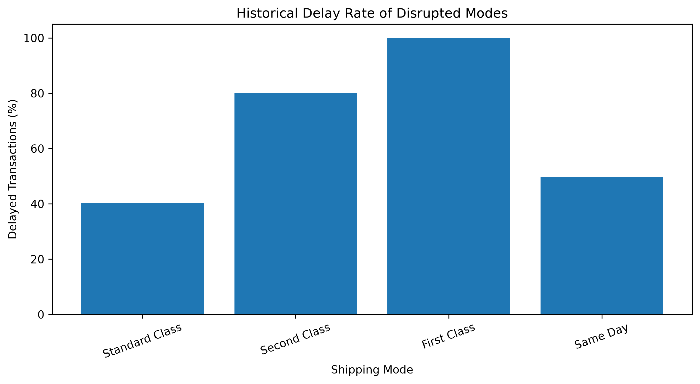
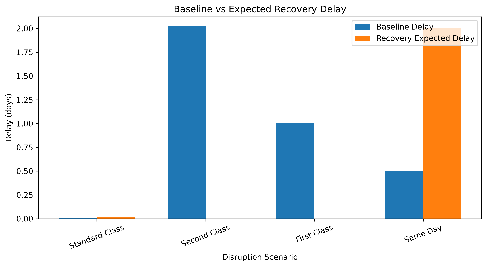
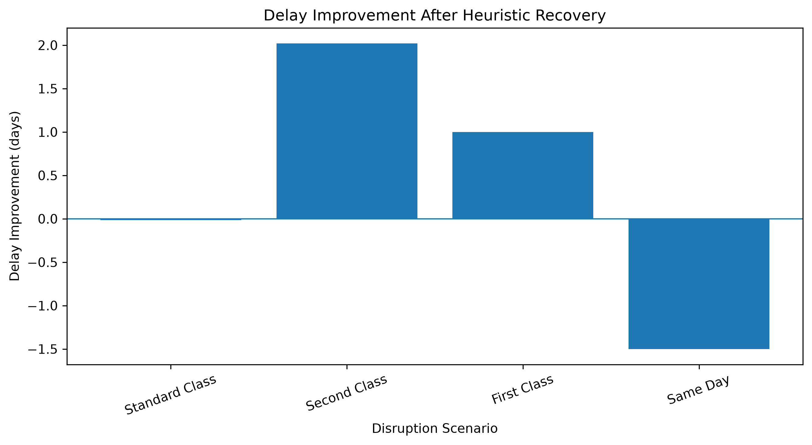
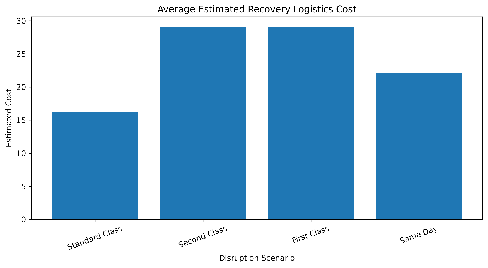

# Dynamic Supply Chain Disruption Recovery

Adaptive logistics planning with heuristic search on the DataCo Smart Supply Chain dataset.

When a shipping mode becomes unavailable, every order booked on it has to move to another mode. This project treats that as a heuristic search problem: each affected order is scored against every alternative mode on estimated cost, expected delay and historical delay rate, then reassigned to the lowest-scoring one. A Streamlit dashboard lets you trigger a disruption and explore the recovery plan, the logistics network and the performance metrics.

---

## Features

- **Data pipeline.** Cleans the raw DataCo file and samples 10,000 European order lines (`random_state = 42`).
- **Network model.** Builds a `networkx` graph of the logistics structure (Market → Region → Country → City).
- **Disruption engine.** Marks one shipping mode unavailable and finds every affected order.
- **Heuristic recovery.** Scores each remaining mode per order and picks the lowest score.
- **Evaluation.** Compares recovery against the original shipments for each disruption scenario.
- **Dashboard.** Four Streamlit pages: Command Center, Recovery Planning, Network and Performance.

---

## Heuristic Scoring Function

For an affected order and a candidate mode *m* (the disrupted mode is excluded):

```
score(m) = cost(m)
         + 20 × expected_delay(m)
         + 15 × delay_rate(m)
         + 10 × delay_rate(m)      (only if the original order was already late)
```

| Term | Definition |
|---|---|
| `cost(m)` | Base mode cost + 2 × quantity. Base costs: Standard 8, Second 12, First 18, Same Day 25 (modelled units) |
| `expected_delay(m)` | max(0, mean historical shipping days of *m* − order's scheduled days) |
| `delay_rate(m)` | Share of historical shipments on *m* that arrived late |

The lowest-scoring candidate becomes the recovery mode. See `HeuristicSearch.calculate_score` in `src/heuristic_search.py`.

---

## Dataset

**DataCo Smart Supply Chain for Big Data Analysis** (Constante, Silva & Pereira, Mendeley Data v5, 2019, doi:[10.17632/8gx2fvg2k6.5](https://doi.org/10.17632/8gx2fvg2k6.5)).

The raw file isn't tracked because of its size. To rebuild the pipeline, download it to `data/raw/DataCoSupplyChainDataset.csv`. The processed CSVs the dashboard needs are already in `data/processed/`.

---

## Project Structure

```
dynamic-supply-chain-recovery/
├── app.py                          # Streamlit dashboard
├── requirements.txt
├── data/
│   ├── raw/                        # DataCoSupplyChainDataset.csv (not tracked)
│   └── processed/                  # subset, route data, recovery and evaluation results
├── outputs/figures/                # PNG charts
└── src/
    ├── preprocessing.py            # raw → supply_chain_subset.csv
    ├── network_builder.py          # → route_data.csv + network statistics
    ├── heuristic_search.py         # HeuristicSearch class
    ├── disruption_engine.py        # single disruption scenario
    ├── multi_scenario_experiment.py# all four scenarios (order level)
    ├── evaluation.py               # baseline vs recovery (order level)
    ├── row_level_recovery.py       # all four scenarios (record level)
    ├── row_level_evaluation.py     # baseline vs recovery (record level)
    ├── analyze_recovery.py         # descriptive analysis
    └── visualization.py            # figures → outputs/figures/
```

---

## Installation

```bash
git clone https://github.com/praveena-anand/dynamic-supply-chain-recovery.git
cd dynamic-supply-chain-recovery
python -m venv .venv
source .venv/bin/activate        # Windows: .venv\Scripts\activate
pip install -r requirements.txt
```

---

## Usage

### Run the dashboard

From the repository root:

```bash
streamlit run app.py
```

Pick a disrupted shipping mode in the sidebar, then switch between:

| Page | What it shows |
|---|---|
| **Command Center** | Current scenario, recommended recovery and recent activity |
| **Recovery Planning** | Recovery strategy, recovery flow and recovered transactions |
| **Network** | Network graph, geographic distribution and recovery routes |
| **Performance** | Delay comparison, delivery impact and historical reliability |

### Rebuild from raw data

From the repository root, in order:

```bash
python src/preprocessing.py
python src/network_builder.py
python src/disruption_engine.py
python src/multi_scenario_experiment.py
python src/evaluation.py
python src/row_level_recovery.py
python src/row_level_evaluation.py
python src/visualization.py
```

---

## Results

Record-level results on the 10,000-line European subset; each row is one scenario in which that mode is unavailable.

| Disrupted mode | Affected records | Recovery rate | Primary recovery mode | Baseline avg delay (days) | Recovery expected delay (days) | Avg est. cost |
|---|---:|---:|---|---:|---:|---:|
| Standard Class | 5,906 | 100% | Second Class | 0.01 | 0.02 | 16.2 |
| Second Class | 2,012 | 100% | Same Day | 2.02 | 0.00 | 29.1 |
| First Class | 1,544 | 100% | Same Day | 1.00 | 0.00 | 29.1 |
| Same Day | 538 | 100% | First Class | 0.50 | 2.00 | 22.2 |

Recovery delays are estimated from historical mode averages, not observed outcomes.

| | |
|---|---|
|  |  |
|  |  |

---

## Author

**Praveena Anand**
Department of Computer Science and Engineering, Amrita School of Computing, Amrita Vishwa Vidyapeetham, Chennai, India
